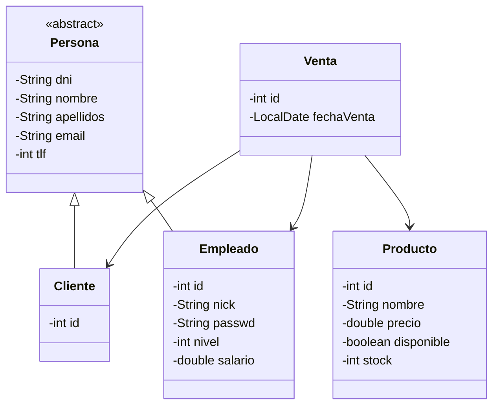

# 🥡 App de Gestión — Restaurante Chino "TAN-DAO-BIEN"

Aplicación de escritorio para gestionar un restaurante chino: control de **clientes**, **productos** (con stock), **empleados/usuarios** y **ventas**, con inicio de sesión por roles y persistencia de datos en ficheros.

Desarrollada en **Java** con **JavaFX** (interfaces en FXML) y gestionada con **Maven**.

---

## 📋 Características

- 🔐 **Inicio de sesión** con usuario y contraseña, con roles de **Administrador** y **Camarero**.
- 👥 **Mantenimiento de clientes**: alta, baja, modificación y consulta en tabla.
- 🍜 **Mantenimiento de productos**: alta, baja, modificación, precio, stock y disponibilidad.
- 🧑‍🍳 **Mantenimiento de usuarios (empleados)**: gestión completa de plantilla, solo para administradores.
- 🧾 **Venta de productos**: registra la venta indicando cliente, empleado y producto; comprueba el stock y lo descuenta automáticamente.
- 📦 **Stock máximo**: calcula el valor total en stock (stock × precio) de un producto.
- 🧮 **Calculadora** integrada (operaciones básicas, raíz, funciones trigonométricas, π y e).
- 📖 **Manual del usuario** con una captura anotada de las pantallas de mantenimiento.
- 💾 **Persistencia** de empleados, productos, clientes y ventas mediante serialización de objetos a ficheros `.dat`.
- 🪟 **Ventanas modales** y confirmaciones antes de dar de baja o salir de la aplicación.

---

## 🖥️ Pantallas y menús

Tras iniciar sesión, la ventana principal muestra el nombre del restaurante, el **usuario activo**, su **rol** y un botón **Cambiar usuario**.

| Menú | Opción | Descripción |
|------|--------|-------------|
| **Mantenimiento** | Clientes | Alta, baja y modificación de clientes. |
| | Productos | Alta, baja y modificación de productos y stock. |
| **Operaciones** | Venta de productos | Registro de ventas y listado de las realizadas. |
| **Config. App** | Mantenimiento usuarios | Gestión de empleados (**solo administradores**). |
| | Stock máximo en productos | Valor total del stock de un producto. |
| | Stock mínimo en productos | *Pendiente de implementar.* |
| **Utilidades** | Manual del usuario | Guía visual de las pantallas de mantenimiento. |
| | Calculadora | Calculadora gráfica. |
| **Otros** | Guardar datos en disco | Guarda todos los datos en los ficheros `.dat`. |
| | Salir App | Cierra la aplicación (pide confirmación). |

> ⚠️ Los datos **solo se guardan en disco** al usar **Otros → Guardar datos en disco**. Los cambios no guardados se pierden al salir.

### Roles

| Nivel | Rol | Permisos |
|-------|-----|----------|
| `0` | Administrador | Acceso a todo, incluido el mantenimiento de usuarios. |
| Distinto de `0` | Camarero | Todo excepto el mantenimiento de usuarios. |

---

## 🚀 Primeros pasos

Si no existen datos previos, la aplicación crea un administrador por defecto:

| Usuario | Contraseña | Rol |
|---------|------------|-----|
| `Admin` | `1234` | Administrador |

Flujo habitual de uso:

1. Inicia sesión con `Admin` / `1234` (cambia la contraseña desde *Mantenimiento usuarios*).
2. Da de alta **productos** (ID, nombre, precio, stock, disponible).
3. Da de alta **clientes** y, si hace falta, más **empleados**.
4. Registra **ventas** introduciendo el ID de venta, de empleado, de cliente y de producto.
5. Pulsa **Guardar datos en disco** antes de salir.

---

## 🧩 Modelo de datos



Todas las clases implementan `Serializable`. En el proyecto se incluye además el diagrama original en `DiagramaClasesFinal.dia` (formato Dia).

---

## ▶️ Cómo ejecutarlo

### Requisitos

- **JDK 11 o superior**.
- **Maven**.
- JavaFX (`javafx-controls` y `javafx-fxml`, versión 13): se descarga automáticamente con Maven.
- La librería local **`MiLibreria`** (`MiLibreria:MiLibreria:1.0`), que **no está en Maven Central** y debe instalarse en tu repositorio local de Maven. Aporta el paquete `modulos` con `FuncionesGraficas` (avisos y mensajes) y `Ficheros` (lectura y escritura de datos serializados).

  ```bash
  mvn install:install-file -Dfile=MiLibreria.jar -DgroupId=MiLibreria -DartifactId=MiLibreria -Dversion=1.0 -Dpackaging=jar
  ```

### Compilar y lanzar

Ejecuta **siempre desde la carpeta del proyecto** (`MartinezGallardoPabloFinal/`), ya que las rutas de los ficheros de datos son relativas (`src/main/java/ficheros/`):

```bash
cd MartinezGallardoPabloFinal
mvn clean javafx:run
```

También puedes abrir el proyecto con **NetBeans** y pulsar *Run*. El `pom.xml` incluye configuraciones para depuración (`javafx:run@debug`) y generación de imagen con `jlink`.

---

## 📁 Estructura del proyecto

```
AppGestionRestauranteChino/
└── MartinezGallardoPabloFinal/
    ├── pom.xml
    ├── nbactions.xml
    ├── DiagramaClasesFinal.dia
    └── src/main/
        ├── java/
        │   ├── module-info.java
        │   ├── clasesJava/                  # Modelo
        │   │   ├── Persona.java             # Clase abstracta
        │   │   ├── Cliente.java
        │   │   ├── Empleado.java
        │   │   ├── Producto.java
        │   │   └── Venta.java
        │   ├── com/mycompany/martinezgallardopablofinal/
        │   │   ├── App.java                 # Arranque, carga y guardado de datos
        │   │   ├── InicioSesionController.java
        │   │   ├── PrincipalController.java
        │   │   ├── MantenimientoClientesController.java
        │   │   ├── MantenimientoProductosController.java
        │   │   ├── MantenimientoUsuariosController.java
        │   │   ├── OperacionVentasController.java
        │   │   ├── StockMaximoController.java
        │   │   ├── CalculadoraGraficaController.java
        │   │   └── ManualController.java
        │   └── ficheros/                    # Ficheros .dat (datos persistentes)
        └── resources/
            ├── com/mycompany/martinezgallardopablofinal/*.fxml   # Una vista por pantalla
            └── img/                         # Captura usada en el manual
```

### Diseño

- **`App`** carga los cuatro ficheros de datos al arrancar (`datosEmpleados.dat`, `datosProductos.dat`, `datosClientes.dat`, `datosVentas.dat`), crea el administrador por defecto si no hay empleados y abre la ventana de inicio de sesión.
- Cada pantalla es un par **FXML + controlador** (patrón MVC de JavaFX); las listas de datos se comparten entre controladores mediante el método estático `datosEntrada(...)`.
- Las tablas (`TableView`) se rellenan con `ObservableList` y, al seleccionar una fila, se vuelcan los datos en los campos del formulario.
- Las pantallas secundarias se abren como **ventanas modales** con `App.abrirNuevaVentana(...)`.

---

## 🛠️ Limitaciones y errores conocidos

Cosas que conviene saber si vas a seguir desarrollando el proyecto:

- **Inicio de sesión con un usuario inexistente** provoca una `NullPointerException`: se accede al empleado antes de comprobar si es `null`, por lo que el mensaje "Usuario no encontrado" nunca llega a mostrarse.
- **Clientes y usuarios**: al seleccionar una fila de la tabla, el campo **DNI** se rellena con el *nombre* y el campo **Email** con los *apellidos*. Si después pulsas *Modificar*, se guardarían esos valores erróneos.
- **Mantenimiento de usuarios**: *Baja* y *Modificar* comprueban el ID contra la lista de **clientes** (`comprobarIdCliente`) en lugar de la de empleados, y *Modificar* no actualiza el nivel.
- **Ventas**: no se valida que el cliente y el empleado existan, que el ID de venta sea único ni que el producto esté marcado como disponible.
- **Productos**: al seleccionar una fila no se actualiza la casilla *Disponible*.
- **Stock mínimo** aparece en el menú pero no está implementado.
- Las **contraseñas** se guardan y se muestran en texto plano.
- **Primera ejecución**: como los ficheros `.dat` aún no existen cuando se cargan, es posible que aparezca un aviso de error que desaparece al guardar los datos por primera vez.
- Las ventanas principales **no se pueden cerrar con la "X"** (se consume el evento): hay que usar *Salir App*.
- El código pasa **nueve parámetros** por pantalla mediante `datosEntrada(...)`, y en `App.main` el fichero de ventas se envía en el lugar del de empleados (sin efecto práctico, pues el guardado está centralizado en `App.guardarDatos`). Sería recomendable centralizar el estado en una clase compartida.
- Las **rutas relativas** obligan a lanzar la aplicación desde la carpeta del proyecto.

---

## 👤 Autor

Proyecto final desarrollado por **Pablo Martínez Gallardo**.

---

## 📄 Licencia

Proyecto académico.
